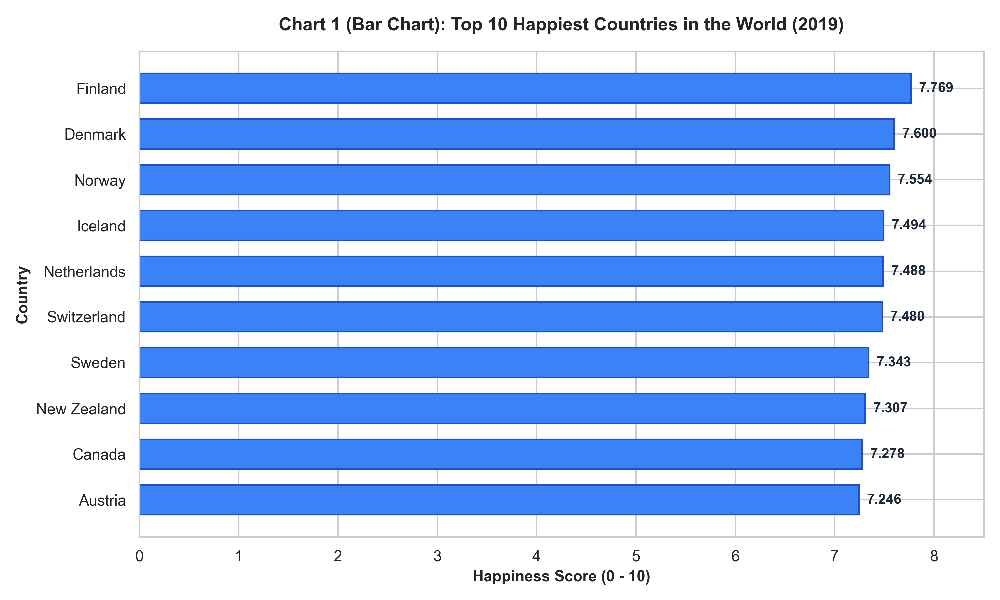
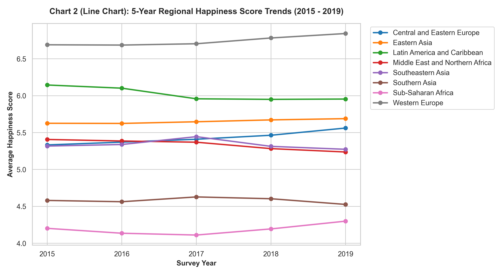
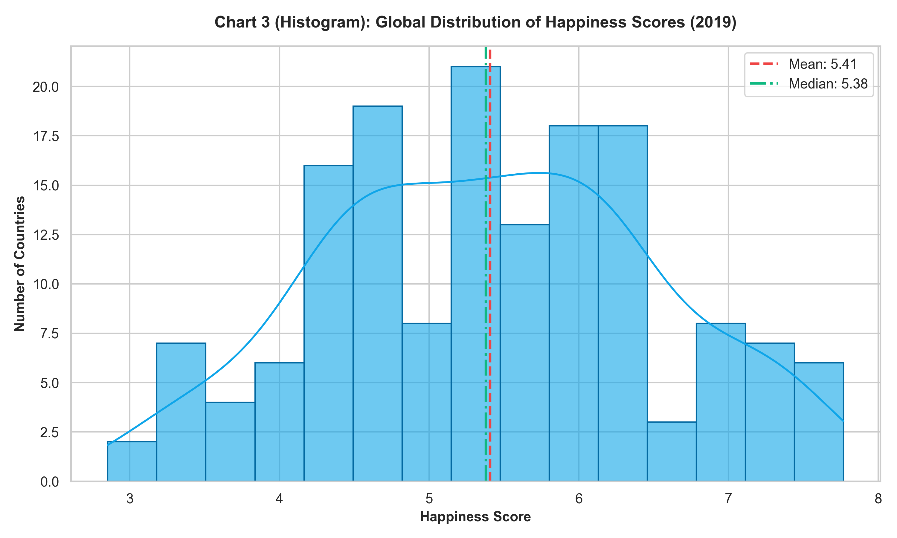
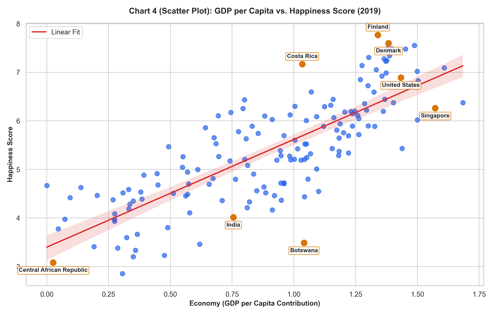
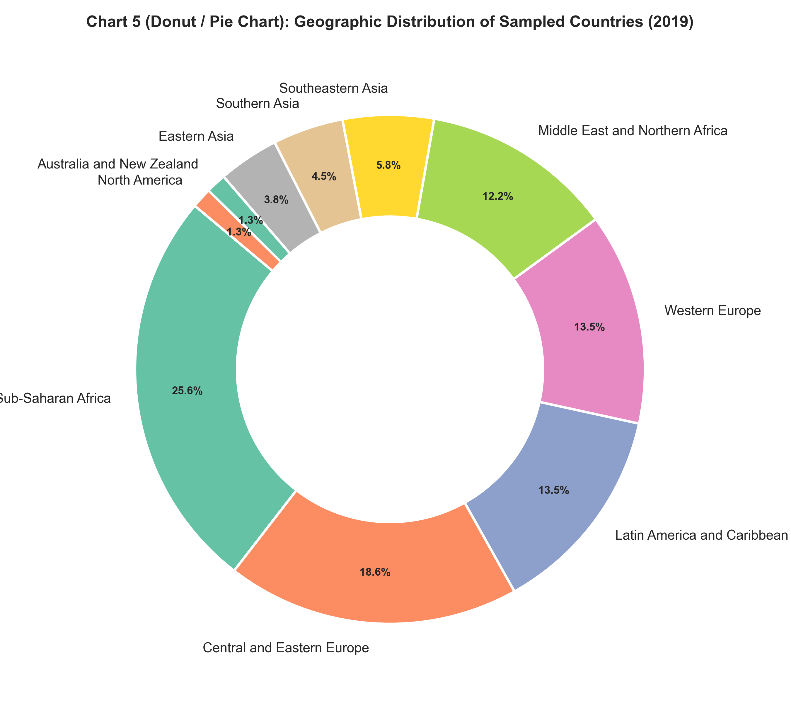
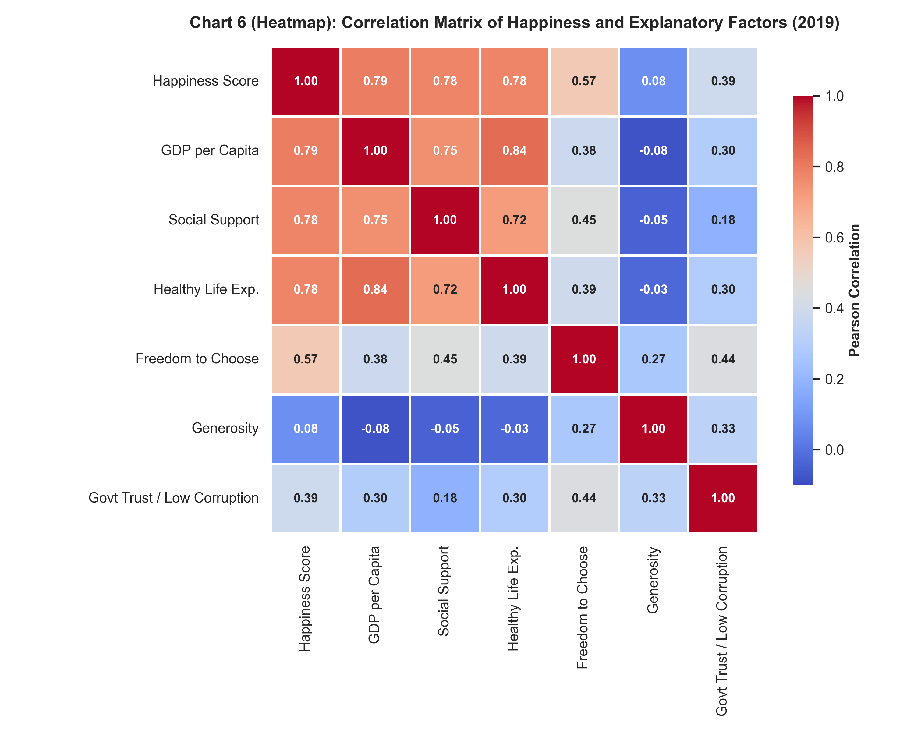
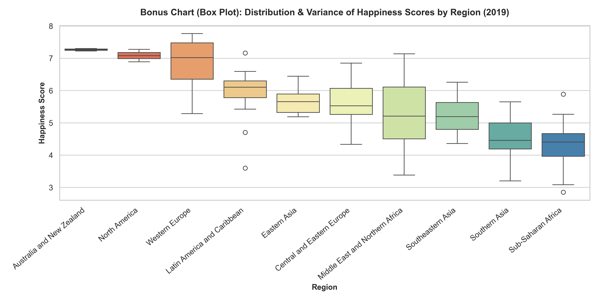

# 🌍 World Happiness Report — Exploratory Data Analysis & Insights

[](https://python.org)
[](https://pandas.pydata.org)
[](https://seaborn.pydata.org)
[](https://colab.research.google.com/github/shiv123-coder/HappyEDA/blob/main/World_Happiness_EDA.ipynb)
[](https://opensource.org/licenses/MIT)

**Pluto Academy AI & Machine Learning Internship Program — Project 01**  
**Author:** Shivshankar Dhareppa Mali  
**Offer Letter Ref:** `PA-OL-AIML-2026-0934`  
**Dataset Source:** [Kaggle World Happiness Report (UNSDSN)](https://www.kaggle.com/datasets/unsdsn/world-happiness)

---

## 📖 Project Overview
This project delivers a comprehensive Exploratory Data Analysis (EDA) on the global **World Happiness Report** (2015–2019), investigating the socio-economic and institutional drivers of human well-being across over 150 countries.

Through rigorous data cleaning, schema harmonization, five-question deep-dive analysis, and publication-grade visualizations, this project answers fundamental questions regarding what truly drives societal happiness, identifies regional disparities, and uncovers nations that achieve outsized well-being relative to their economic wealth.

---

## 🎯 What We Built (Rubric Alignment)

### 1. Step 1 — Load & Inspect Data
- Loaded 5 annual survey releases (2015–2019) containing 155–158 countries per year.
- Validated column types, dimensions, missing value distributions, and duplicate records (0 duplicate records found).
- **5-Line Dataset Summary**:
  1. *Core Subject*: National happiness and subjective well-being evaluated globally on a Cantril ladder scale (0 to 10).
  2. *Key Dimensions*: Quantifies contributions from GDP per capita, social support, healthy life expectancy, freedom to make choices, generosity, and trust in institutions (lack of corruption).
  3. *Coverage*: 156 surveyed countries in 2019 and over 780 country-year observations longitudinally from 2015 to 2019.
  4. *Data Health*: High data integrity with zero duplicates and only a single missing data point across the multi-year corpus (2018 UAE corruption).
  5. *Challenge*: Significant schema variations across years requiring systematic column harmonization and geopolitical region mapping.

### 2. Step 2 — Data Cleaning Decisions & Justifications
- **Column Harmonization**: Standardized inconsistent column titles (e.g. `Family` vs `Social support`, `Economy (GDP per Capita)` vs `GDP per capita`) into a clean schema: `country`, `region`, `rank`, `score`, `gdp`, `social`, `health`, `freedom`, `generosity`, `corruption`, `year`.
- **Region Imputation**: Reconstructed missing regional metadata for 2018 and 2019 using a historical lookup mapping from 2015–2016 combined with alias normalization for political entity changes (e.g., Hong Kong, Taiwan, North Macedonia, Gambia).
- **Missing Value Handling**: Imputed the single missing corruption value (United Arab Emirates in 2018) using the nation's multi-year mean ($0.288$) rather than dropping the country record.
- **Dimensionality Pruning**: Removed year-specific statistical bounds (`Standard Error`, `Whisker.high`, `Whisker.low`, `Dystopia Residual`) to ensure uniform feature vectors across all five years.

### 3. Step 3 — Exploratory Data Analysis (5 Key Questions)
- **Q1: Top 10 vs. Bottom 5**: Finland, Denmark, Norway, and Iceland dominate the top spots (scores $>7.49$), while South Sudan, Central African Republic, and Afghanistan sit at the bottom ($<3.25$). Top nations enjoy $3.5\times$ higher social support and $2.8\times$ higher life expectancy than bottom nations.
- **Q2: Strongest Correlations**: GDP per Capita ($r = 0.794$) and Social Support ($r = 0.777$) show the strongest positive correlation with happiness, followed by Healthy Life Expectancy ($r = 0.780$) and Freedom ($r = 0.567$). Generosity displays negligible correlation ($r = 0.076$).
- **Q3: Regional Disparities**: Western Europe (Mean: $6.898$) and North America (Mean: $7.085$) lead all regions. Latin America exhibits the widest internal range ($\text{spread} = 2.975$ points), ranging from Costa Rica ($7.167$) to Venezuela ($4.707$).
- **Q4: 5-Year Trajectory (2015–2019)**: Countries with largest improvements: Benin ($+1.54$ points), Ivory Coast ($+1.86$ points), and Honduras ($+0.98$ points). Steepest collapse: Venezuela ($-2.10$ points) due to severe socio-economic crises.
- **Q5: Punching Above Wealth**: Costa Rica (Happiness Rank 12 vs GDP Rank 55, $+43$ spots), Mexico ($+37$), and Guatemala ($+47$) achieve happiness levels far exceeding their income rank through exceptional community ties and health. Conversely, Botswana (Happiness Rank 148 vs GDP Rank 75, $-73$ spots) dramatically underperforms its economic output.

---

## 📊 Visualizations Gallery (7 Charts)

All charts are generated using Seaborn and Matplotlib with consistent typography and color palettes.

| Chart Type | Description | Preview |
| :--- | :--- | :--- |
| **01. Bar Chart** | Top 10 Happiest Countries in 2019 with exact score callouts |  |
| **02. Line Chart** | 5-Year Regional Happiness Score Trends (2015–2019) |  |
| **03. Histogram + KDE** | Global Distribution of Happiness Scores with Mean & Median markers |  |
| **04. Scatter Plot** | GDP per Capita vs. Happiness Score with key country annotations |  |
| **05. Donut Chart** | Regional representation of surveyed nations in the 2019 sample |  |
| **06. Heatmap** | Pearson Correlation Matrix across all contributory factors |  |
| **07. Box Plot (Bonus)** | Regional Distribution and Variance in Happiness Scores |  |

---

## 📑 Step 5 — Insights Report & Recommendations

### 5 Data-Backed Insights:
1. **Economic Foundation is Essential but Insufficient (Chart 4 & 6)**:
   While GDP per capita is strongly correlated with happiness ($r = 0.794$), wealth alone does not guarantee high well-being. Nations like Singapore and Qatar have top-tier GDP per capita (~$1.68$) yet rank 34th and 29th in happiness. In contrast, Costa Rica achieves 12th place globally despite having roughly two-thirds the GDP per capita of wealthy peers ($1.03$ vs $1.68$), driven by robust social safety nets and healthcare access.
2. **Social Capital and Mutual Support Are Primary Multipliers (Chart 6 & Table Q1)**:
   Social support has the second-highest correlation ($r = 0.777$) with happiness. Between the top 10 happiest nations and the bottom 5, the social support score drops by nearly $3.5\times$ (from $1.53$ to $0.44$). Organizations and policymakers should invest aggressively in community resilience, psychological safety, and social welfare infrastructure.
3. **Geographic Inequality Is Extreme but Stable (Chart 2 & 5)**:
   Western Europe and North America consistently lead global happiness scores with regional averages above $6.80$, whereas Sub-Saharan Africa lags at $4.31$ (a $2.5$-point gap). Over the 5-year longitudinal analysis (2015–2019), regional trajectories remained remarkably stable, indicating that structural reforms require decades of sustained capital and institutional reinforcement.
4. **The Economic Efficiency Gap — Punching Above Wealth (Table Q5 & Chart 4)**:
   Latin American countries consistently rank much higher in happiness than their economic rank would predict (e.g., Costa Rica $+43$ spots, Mexico $+37$ spots, Guatemala $+47$ spots). Conversely, certain African countries such as Botswana (Rank 148 in happiness vs Rank 75 in GDP, gap of $-73$) suffer severely from inequality and institutional challenges despite mineral wealth.
5. **Generosity Does Not Drive National Happiness (Chart 6 & Table Q2)**:
   Generosity showed an almost negligible correlation with overall happiness ($r = 0.076$). This counter-intuitive finding demonstrates that while individual charitable acts provide personal fulfillment, broad national happiness is rooted primarily in systemic institutional health, economic security, and public healthcare rather than voluntary philanthropy.

### 😲 Finding That Surprised Me the Most (3–5 Lines):
> *"The most surprising discovery was the complete divergence between wealth and happiness in the **Rank Disparity Analysis (Question 5 & Chart 4)**. Nations like Botswana and Qatar produce extraordinarily high economic output per capita, yet score lower in life satisfaction than Latin American nations with a fraction of their wealth like Costa Rica and Guatemala. This conclusively disproves the premise that maximizing GDP alone optimizes human well-being, highlighting that social cohesion, freedom, and healthcare access are the true linchpins of life satisfaction."*

---

## 📂 Project Structure
```text
HappyEDA/
├── data/
│   ├── 2015.csv
│   ├── 2016.csv
│   ├── 2017.csv
│   ├── 2018.csv
│   └── 2019.csv
├── visualizations/
│   ├── 01_top_10_countries_bar.png
│   ├── 02_regional_trends_line.png
│   ├── 03_score_distribution_histogram.png
│   ├── 04_gdp_vs_happiness_scatter.png
│   ├── 05_regional_breakdown_pie.png
│   ├── 06_correlation_heatmap.png
│   └── 07_regional_boxplot.png
├── World_Happiness_EDA.ipynb    # Modular, bite-sized Jupyter Notebook with all outputs
└── README.md                    # Project documentation & insights report
```

---

## 🚀 How to Run Locally

1. **Clone the repository:**
   ```bash
   git clone https://github.com/shiv123-coder/HappyEDA.git
   cd HappyEDA
   ```

2. **Set up Python environment & dependencies:**
   ```bash
   pip install pandas numpy matplotlib seaborn jupyter nbclient
   ```

3. **Launch the Jupyter Notebook:**
   ```bash
   jupyter notebook World_Happiness_EDA.ipynb
   ```

---

## 🎓 Internship & Submission Information
- **Program:** Pluto Academy AI & Machine Learning Internship (1-Month Remote)
- **Intern:** Shivshankar Dhareppa Mali (`PA-OL-AIML-2026-0934`)
- **Email:** `shivashankrmali7@gmail.com`
- **Evaluation Criteria:** Data Cleaning (20) + EDA Depth (25) + Visualizations (25) + Insights Report (20) + Code & Repository Quality (10) = 100 Marks.
